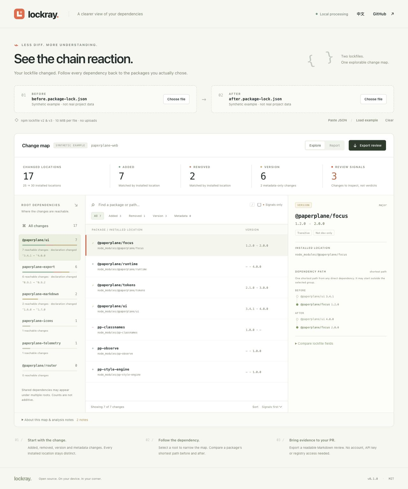

# Lockray

**A lockfile changed. See which dependency trees changed with it.**

[简体中文](README.zh-CN.md) · [Model and boundaries](docs/MODEL.md) · [Product and launch plan](docs/PRODUCT.md) · [Contributing](CONTRIBUTING.md)

Lockray compares two npm `package-lock.json` files and turns a wall of JSON into a review workspace. Group changes by the direct dependencies that can reach them, select a package, and inspect its shortest dependency path before and after the change.

It runs locally in your browser or terminal. **No account, API key, registry lookup, or package installation is needed to analyze a lockfile.** Lockray does not execute the packages described by your input.



*The example uses synthetic packages. The counters describe installed package locations, which can include several copies of the same package.*

## Review a dependency update in context

A direct dependency bump can touch many transitive entries. A plain diff tells you the fields changed; Lockray helps you navigate their recorded relationships:

```text
Before: project → build-kit@2.4.0 → parser@1.8.0
After:  project → build-kit@3.0.0 → parser@2.0.0
```

- **Find your starting point.** Group changed installed locations under the direct dependencies that can reach them in either lockfile.
- **Follow the evidence.** Inspect a shortest path from the root, the package's installation location, and its recorded before/after fields.
- **Separate version changes from metadata.** Review additions, removals, version changes, and changes to source, integrity, install-script flags, or dependency metadata.
- **Keep declarations distinct.** Range and dependency-category changes at the root are reported separately, even when installed versions stay the same.
- **Notice review signals.** Source-host or protocol changes, newly recorded install scripts, and integrity changes deserve context. Signals are prompts for human review; they do not establish a vulnerability or malicious package.
- **Take the review to a PR.** Export a Markdown report or structured JSON using the browser or CLI.
- **Keep inputs local.** Analysis uses no upload endpoint, analytics, remote fonts, or registry service. Browser inputs live in tab memory.

This is a **locked-tree reachability tool**. A dependency path explains how entries are connected in the supplied snapshots. It does not prove why npm's resolver selected a version, that code uses a dependency, or that a change caused a regression.

## Run locally

Requires **Node.js 22 or newer**. From this repository's directory:

```sh
npm start
```

Open the loopback URL printed in your terminal. No `npm install` step is required. Load the included synthetic example, or load a before and after `package-lock.json`.

1. Compare the two snapshots and inspect the overall change counts.
2. Choose a direct dependency to narrow the view to changes reachable from it.
3. Select a changed package to compare its fields and shortest before/after paths.
4. Review any signals in context, then download a Markdown or JSON report.

The browser app is static. It can be built for any static HTTP host:

```sh
npm test
npm run build
npm run package:release
```

The static build is written to `dist/`. Release packaging requires Git and an existing commit: it builds reproducible source/site ZIPs from **committed HEAD**, excludes uncommitted changes, and writes them with `SHA256SUMS.txt` to `releases/v0.1.0/`. Use `npm run package:release -- --force` to replace existing release files. Module loading requires HTTP or HTTPS; opening `index.html` directly through `file://` is not supported.

## Command line

Keep both lockfile revisions as local files, then compare them:

```sh
# Try the included synthetic pair.
node bin/lockray.js samples/before.package-lock.json samples/after.package-lock.json

node bin/lockray.js before-package-lock.json after-package-lock.json

node bin/lockray.js before-package-lock.json after-package-lock.json \
  --format markdown --output dependency-review.md

node bin/lockray.js before-package-lock.json after-package-lock.json \
  --format json --output dependency-review.json

node bin/lockray.js --help
```

| Option | Purpose |
| --- | --- |
| `--format markdown\|json` | Choose the report format; the default is Markdown |
| `--output <path>` | Write a report instead of printing it to stdout |
| `--force` | Permit replacing an existing report file |
| `--fail-on-signals` | Return a nonzero exit code when the comparison contains review signals |
| `--help` | Show the available options |
| `--version` | Print the version |

The CLI reads the two files and never fetches tarballs or invokes npm. Existing output files require `--force`; source inputs cannot be used as output destinations, including symlink and hardlink aliases. Exit codes are `0` for success, `1` for review signals when `--fail-on-signals` is supplied, and `2` for input or I/O errors. Review the complete output before using signals as a CI policy: legitimate dependency updates can produce them.

Lockray is not currently distributed through npm. Use the repository commands above.

## What the model covers

| Input or question | v0.1 scope |
| --- | --- |
| npm lockfile versions | `lockfileVersion: 2` or `3`, with a `packages` map; a root entry enables direct-dependency explanations |
| Package identity for comparison | Exact installed location, such as `node_modules/a/node_modules/b` |
| Dependency attribution | Recorded dependency reachability from root declarations |
| Path explanation | A shortest supported dependency path in each snapshot |
| Source and script review | Lockfile metadata only; no downloaded artifact or script inspection |
| Other lockfile formats | npm v1, Yarn, pnpm, Bun, and other ecosystems are not supported |

Several direct dependencies can reach the same changed location. Their groups overlap, so group counts must not be summed as a project-wide total. A path is one shortest explanation from any root, not every possible route; it may start at a different root than the selected group. Package locations that move are reported as an addition and a removal; Lockray does not infer a relocation.

Each input is limited to **10 MiB**, with up to **20,000 non-root package entries** and **100,000 declared dependency edges**. All-root attribution has a **100,000-relationship work budget per snapshot**; if reached, root groups may be incomplete. Path output has a separate **50,000-segment or 4,000,000-character budget across the report**; paths beyond it are explicitly marked omitted, which does not mean the package is unreachable. Missing root metadata permits a location diff but produces a warning and cannot provide root paths. Coverage notes identify these limits.

The analysis is a bounded model of lockfile metadata, not npm Arborist or a full package installation. Workspaces, links, aliases, optional dependencies, and peer relationships have additional interpretation limits. An absent path can mean a relationship is outside the supported model. See [the model document](docs/MODEL.md) for the supported edges, limits, and unresolved cases.

Lockray does not scan advisories, inspect tarball contents, verify a registry's ownership, estimate bundle size, or determine runtime reachability. A `hasInstallScript` flag records script presence, not what that script does. An integrity field records a declared digest; Lockray does not fetch bytes to validate it. The npm registry hostname can be a placeholder for the configured registry.

## Privacy and exports

Inputs and derived graphs remain in browser memory until you clear or reload the page. The app has no analysis backend or telemetry. Serving the page still makes ordinary requests for app files and built-in examples; your hosting provider and browser extensions have their own behavior.

**Reports are not anonymized.** Package names, locations, version strings, registry URLs, and other recorded metadata can identify a private project. Exports can include source URLs containing credentials if those were present in an input. Check a report before sharing it, and use synthetic fixtures in public issues. See [SECURITY.md](SECURITY.md).

## Related tools

| Tool | Focus | Lockray's focus alongside it |
| --- | --- | --- |
| [LockSignal](https://github.com/aminhanifm/LockSignal) | Local npm lockfile comparison with review signals, evidence, browser and CLI reports | Reachability groups rooted at direct dependencies and shortest before/after paths |
| [lockdiff](https://github.com/root-Manas/lockdiff) | CLI comparison of npm installed locations and review metadata | An interactive browser workspace for exploring the relationships behind the diff |
| [npm-diff](https://github.com/marketplace/actions/npm-diff) | Formatted lockfile summaries in GitHub Actions | A local two-file review without connecting a repository or running an Action |
| [`npm explain`](https://docs.npmjs.com/cli/commands/npm-explain/) | Explain packages in a project's installed dependency tree | Compare two saved lockfile snapshots without installing either tree |

These projects are independent. Lockray does not bundle their implementations and does not claim to replace a vulnerability scanner or a package manager.

## Contribute

Useful contributions include minimal lockfile fixtures, corrections to path resolution backed by npm behavior, clearer review explanations, accessibility improvements, and reports from real dependency updates with private data removed. Start with [CONTRIBUTING.md](CONTRIBUTING.md).

MIT © 2026 Songxin Qu. See [LICENSE](LICENSE).
