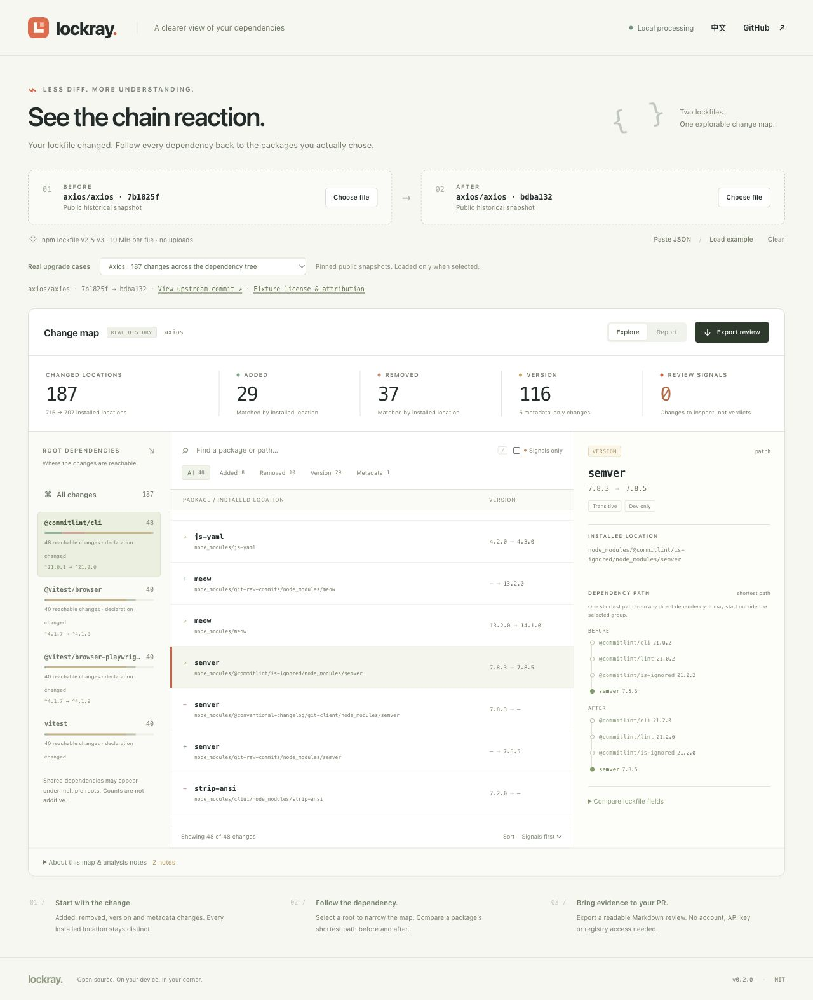

# Lockray

**锁文件变了。看清哪些依赖树也跟着变了。**

**[在线体验 — 无需登录](https://qsxustc.github.io/lockray/)** · **[真实升级案例](docs/REAL-CASES.md)** · [下载 v0.1.0](https://github.com/qsxustc/lockray/releases/tag/v0.1.0) · [GitHub](https://github.com/qsxustc/lockray)

[English](README.md) · [模型与边界](docs/MODEL.md) · [产品与发布计划](docs/PRODUCT.md) · [参与贡献](CONTRIBUTING.md)

Lockray 比较两个 npm `package-lock.json`，把冗长的 JSON diff 变成可探索的审查工作台。按能够到达变动包的直接依赖分组，点击一项变化，查看它在前后两棵锁定依赖树中的最短路径。

它可以在浏览器或终端本地运行。**分析锁文件不需要账户、API Key、查询 registry 或安装文件中描述的依赖。** Lockray 不会执行输入包中的代码。

**v0.2.0 源码新增：**一键加载 Axios、Marked、PDF.js 的四次真实上游依赖升级，附固定文件哈希与可复现的离线核对。详见[更新说明](docs/releases/v0.2.0.md)。上面的正式下载仍为 v0.1.0，v0.2.0 发布包尚未发布。



*截图使用 Axios 的真实公开历史升级：共 187 处安装位置变化，当前筛选为 `@commitlint/cli` 可达的 48 处变化。计数单位为安装位置，同名包的嵌套副本单独计数。*

## 把一次依赖升级放回上下文

直接依赖的一次升级，可能改动许多间接依赖。普通 diff 能告诉你字段变了；Lockray 帮你沿着记录中的关系继续追踪：

```text
之前：项目 → build-kit@2.4.0 → parser@1.8.0
之后：项目 → build-kit@3.0.0 → parser@2.0.0
```

- **从直接依赖开始。** 把变化的安装位置归入前后任一快照中能够到达它的直接依赖。
- **跟着证据看。** 查看从项目根开始的一条最短路径、确切安装位置，以及前后字段。
- **分清版本和元数据。** 检查新增、删除、版本变化，以及来源、完整性、安装脚本标记和依赖元数据变化。
- **单独看根依赖声明。** 即使安装版本没变，范围字符串和依赖类别的变化也会单独记录。
- **发现需要人工检查的信号。** 来源域名变化、新记录的安装脚本和完整性变化都值得结合上下文审查。它们不是漏洞结论，也不代表包具有恶意。
- **带到 PR 里讨论。** 浏览器与 CLI 都能导出 Markdown 报告或结构化 JSON。
- **输入留在本地。** 分析没有上传接口、遥测、远程字体或 registry 查询；浏览器输入仅保存在当前标签页内存中。

这是一个**锁定依赖树可达性工具**。依赖路径说明两份快照中条目的连接关系，不能证明 npm 求解器为什么选择某个版本、业务代码是否使用了这个包，或某项改动是否导致故障。

## 试一次真实依赖升级

当前源码提供**真实升级案例**选择器。选择一个案例，即可从同一静态站点加载完整的前后历史锁文件；浏览器会先核对固定的 SHA-256，再进行分析。不需要安装依赖，也不会执行上游代码。

| 历史升级 | 安装位置 | 变化 |
| --- | --- | --- |
| [Axios 开发依赖更新](https://github.com/axios/axios/commit/e58cf0e91f7fe3992f027cb5c131e9068baa900b) | 687 → 687 | 29 项版本变化 |
| [Axios 依赖树更新](https://github.com/axios/axios/commit/bdba132964d91d2e74341cf0af0a54e4d2346870) | 715 → 707 | 共 187 项：新增 29、删除 37、版本 116、元数据 5 |
| [Marked npm 升级](https://github.com/markedjs/marked/commit/23c82ad02bc8723d9a32c41dd23db155a472d37e) | 660 → 660 | 24 项版本变化 |
| [PDF.js eslint-plugin-jsdoc 大版本升级](https://github.com/mozilla/pdf.js/commit/bf5f6ea4b1b0e689f37dd2dd1b99ad63420537c9) | 965 → 965 | 8 项版本变化 |

这些文件来自真实上游提交与其直接父提交，保留原始字节，没有在本地人为运行更新来制作案例。每对快照均包含来源、大小、哈希和完整上游许可。详见[证据与离线复现](docs/REAL-CASES.md)，或直接查看[数据清单](samples/real/manifest.json)。

Marked 案例发现了一个提示噪声：九个随 npm 打包的包原本就没有独立 integrity。v0.2 将此情况合并为一条覆盖说明，不再产生九个缺少完整性信号；原先存在的校验值如果消失，仍会提示。这不代表对应包或父制品已通过安全验证。

## 下载 v0.1.0

[正式发布页](https://github.com/qsxustc/lockray/releases/tag/v0.1.0) 提供用于本地开发和 CLI 的[源码 ZIP](https://github.com/qsxustc/lockray/releases/download/v0.1.0/lockray-0.1.0-source.zip)、用于 HTTP 托管的[静态站点 ZIP](https://github.com/qsxustc/lockray/releases/download/v0.1.0/lockray-0.1.0-site.zip)，以及 [SHA256SUMS.txt](https://github.com/qsxustc/lockray/releases/download/v0.1.0/SHA256SUMS.txt)。把两个 ZIP 和校验文件下载到同一目录，先验证再解压：

```sh
# macOS
shasum -a 256 -c SHA256SUMS.txt
# Linux
sha256sum -c SHA256SUMS.txt
```

两个压缩包都应显示 `OK`。解压源码 ZIP 后，进入 `lockray-0.1.0/` 运行下面的命令。静态站点 ZIP 已包含构建产物，需要通过 HTTP 或 HTTPS 提供，不支持 `file://` 直接打开。

## 本地运行

需要 **Node.js 22 或更新版本**。在本仓库目录中运行：

```sh
npm start
```

打开终端打印的本地回环地址。不需要先执行 `npm install`。你可以加载合成示例、选择真实历史案例，或分别加载之前、之后的 `package-lock.json`。真实案例选择器包含在 v0.2 源码中；旧版 v0.1 下载包提供合成示例。

1. 比较两份快照，查看整体变化数量。
2. 选择一个直接依赖，聚焦能够从它到达的变化。
3. 点击一个变动包，比较它的字段和前后最短路径。
4. 结合上下文检查信号，再下载 Markdown 或 JSON 报告。

浏览器应用是静态站点，可以构建后部署到静态 HTTP 托管服务：

```sh
npm test
npm run test:real
npm run build
npm run package:release
```

`npm run test:real` 会离线检查真实快照、精确变更集合、原生 Node 查找路径和根依赖归属，不访问 registry。静态构建写入 `dist/`。发布打包需要 Git 和已有提交：它从**已提交的 HEAD** 生成可复现的源码和静态站点 ZIP，不包含尚未提交的修改；压缩包与 `SHA256SUMS.txt` 写入 `releases/v<version>/`。替换已有发布文件使用 `npm run package:release -- --force`。模块加载需要 HTTP 或 HTTPS；不支持通过 `file://` 直接打开 `index.html`。

## 命令行

把两个版本的锁文件保存在本地，然后比较：

```sh
# 先试试内置合成文件对。
node bin/lockray.js samples/before.package-lock.json samples/after.package-lock.json

# 查看 v0.2 源码中的真实历史依赖树变化。
node bin/lockray.js samples/real/axios-tree/before.package-lock.json \
  samples/real/axios-tree/after.package-lock.json

node bin/lockray.js before-package-lock.json after-package-lock.json

node bin/lockray.js before-package-lock.json after-package-lock.json \
  --format markdown --output dependency-review.md

node bin/lockray.js before-package-lock.json after-package-lock.json \
  --format json --output dependency-review.json

node bin/lockray.js --help
```

| 参数 | 用途 |
| --- | --- |
| `--format markdown\|json` | 报告格式，默认为 Markdown |
| `--output <path>` | 把报告写入文件，而不是标准输出 |
| `--force` | 允许替换已经存在的报告文件 |
| `--fail-on-signals` | 比较结果含审查信号时，返回非零退出码 |
| `--help` | 显示可用参数 |
| `--version` | 显示版本 |

CLI 读取这两个文件，不会下载 tarball 或调用 npm。覆盖已有输出需要 `--force`，不允许把源输入作为输出目标，包括符号链接和硬链接别名。退出码：`0` 表示成功，`1` 表示启用 `--fail-on-signals` 后检测到审查信号，`2` 表示输入或 I/O 错误。把信号接入 CI 策略前，请先完整检查报告：正常的依赖更新也会产生这些信号。

Lockray 目前没有发布到 npm，请使用上面的仓库命令运行。

源码已公开在 [GitHub](https://github.com/qsxustc/lockray)。初始版本已在 [GitHub Actions](https://github.com/qsxustc/lockray/actions/runs/38935630469) 中通过 Node.js 22 与 24 的核心/CLI 测试及静态构建。当前验证证据与边界见[验证记录](docs/VALIDATION.md)。

[在线工作台](https://qsxustc.github.io/lockray/) 已通过 [GitHub Pages](https://github.com/qsxustc/lockray/actions/runs/38935630435) 部署，并在 Chromium 中实测了线上合成示例与前后依赖路径。[v0.1.0 发布包](https://github.com/qsxustc/lockray/releases/tag/v0.1.0) 已由成功的 [Release workflow](https://github.com/qsxustc/lockray/actions/runs/38935914873) 从标签提交 [`69ba814`](https://github.com/qsxustc/lockray/commit/69ba8148417931f939f53a01deb242ecdc12f2d1) 构建，该标签也已通过 [CI](https://github.com/qsxustc/lockray/actions/runs/38935915793)。下载资产与校验值见[验证记录](docs/VALIDATION.md)。

## 模型覆盖范围

| 输入或问题 | 当前范围 |
| --- | --- |
| npm 锁文件版本 | `lockfileVersion: 2` 或 `3`，包含 `packages` 映射；根条目用于直接依赖解释 |
| 比较时的包身份 | 确切的安装位置，例如 `node_modules/a/node_modules/b` |
| 依赖归属 | 从根依赖声明出发，在记录中建立可达关系 |
| 路径解释 | 每份快照中一条受支持的最短依赖路径 |
| 来源和脚本审查 | 只检查锁文件元数据，不下载制品、不读取脚本 |
| 其他锁文件 | 不支持 npm v1、Yarn、pnpm、Bun 或其他生态 |

同一个变动位置可能被多个直接依赖到达，因此分组会重叠，不能把每组数字相加作为项目总数。显示的是从任一根依赖出发的一条最短路径，不代表全部路径，起点也可能不同于当前选择的分组。安装位置发生变化时，会报告为新增和删除，Lockray 不会猜测它是不是“迁移”。

每份输入最多 **10 MiB**，支持最多 **20,000 个非根包条目**、**100,000 条声明依赖边**。每份快照的全根依赖归属计算设有 **100,000 次关系处理预算**，达到上限时分组可能不完整。整个报告的路径输出另有 **50,000 个路径节点或 4,000,000 字符预算**，超出后的路径明确标为省略，不代表对应包不可达。缺少根条目的输入可以比较安装位置，但无法提供根依赖路径。这些情况会显示覆盖说明。

分析是一个有明确边界的锁文件元数据模型，不是 npm Arborist，也不是完整的安装过程。workspace、link、alias、可选依赖和 peer 关系有额外限制。找不到路径可能说明关系不在受支持的模型中。详见[模型说明](docs/MODEL.md)。

Lockray 不查询漏洞库、不检查 tarball 内容、不验证 registry 所有权、不估算 bundle 体积，也不判断运行时可达性。`hasInstallScript` 只记录脚本是否存在，不描述脚本内容。`integrity` 只是声明的摘要，本工具不下载字节进行验证。npm registry 主机名还可能是当前配置 registry 的占位表示。

## 隐私与导出

输入与派生图留在浏览器内存，清空或刷新页面后丢弃。应用没有分析后端和遥测。加载页面仍会正常请求应用文件和内置样例；托管服务与浏览器扩展具有各自的行为。

**报告不会自动匿名化。** 包名、安装位置、版本、registry URL 和其他元数据可能暴露内部项目。如果输入中的来源 URL 含凭据，导出也可能包含。分享前检查报告，公开 issue 请使用合成数据。详见 [SECURITY.md](SECURITY.md)。

## 相关工具

| 工具 | 主要用途 | Lockray 与它的侧重点 |
| --- | --- | --- |
| [LockSignal](https://github.com/aminhanifm/LockSignal) | 本地 npm 锁文件比较、审查信号、字段证据、浏览器与 CLI 报告 | 聚焦以直接依赖为根的可达分组，以及前后最短路径 |
| [lockdiff](https://github.com/root-Manas/lockdiff) | CLI 比较 npm 安装位置和审查元数据 | 提供交互式浏览器工作台探索 diff 背后的关系 |
| [npm-diff](https://github.com/marketplace/actions/npm-diff) | 在 GitHub Actions 中生成锁文件摘要 | 拿到两个文件即可在本地审查，不必连接仓库或运行 Action |
| [`npm explain`](https://docs.npmjs.com/cli/commands/npm-explain/) | 解释项目已经安装的依赖树 | 无需安装任何一棵树，即可比较两份保存的锁文件快照 |

这些都是独立项目。Lockray 没有打包它们的实现，也不能替代漏洞扫描器或包管理器。

欢迎贡献可复现的最小锁文件样例、有 npm 行为依据的路径解析修正、更清楚的说明和无障碍改进。请先阅读 [CONTRIBUTING.md](CONTRIBUTING.md)。

MIT © 2026 Songxin Qu，详见 [LICENSE](LICENSE)。第三方历史快照保留[完整上游许可与归属说明](samples/real/README.md)。
